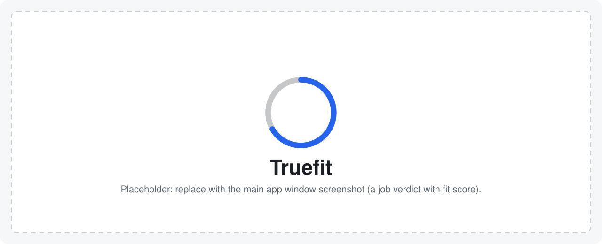
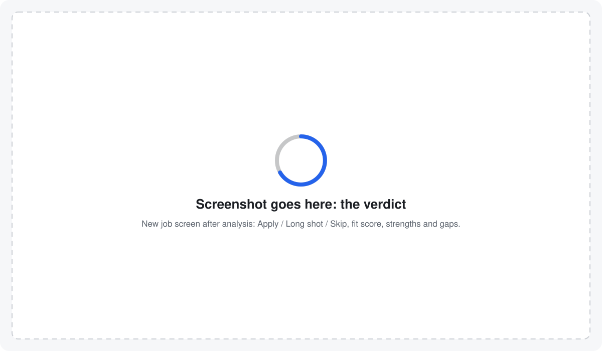
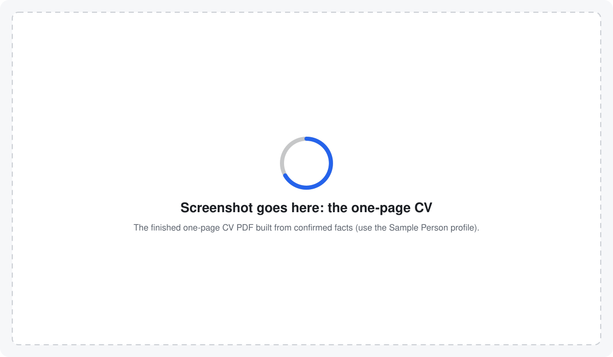
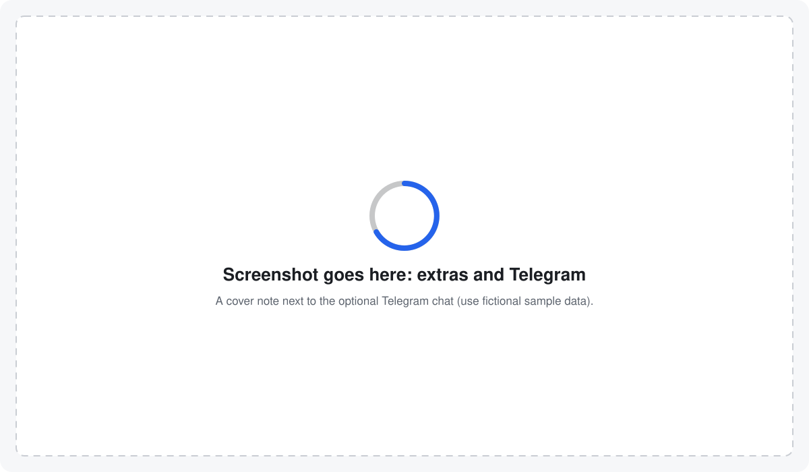
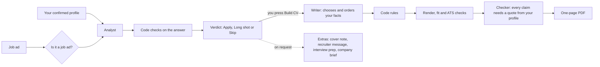

<div align="center">

<picture>
  <source media="(prefers-color-scheme: dark)" srcset=".github/assets/hero-dark.svg">
  <source media="(prefers-color-scheme: light)" srcset=".github/assets/hero-light.svg">
  
</picture>

# **Paste a job ad. Find out if it is worth your time, then get a CV that only says what is true.**

Runs on your Mac, uses the AI service you choose, asks before anything leaves.

[**Download for Mac**](../../releases/latest) · <sub>unsigned: macOS asks you to approve it once, [see the steps](#install-the-unsigned-dmg)</sub>
&nbsp;&nbsp;|&nbsp;&nbsp;
[**Read the docs**](docs/README.md)

Apple silicon Mac · free · MIT licence · needs a Claude or OpenAI account or key

[](LICENSE)


</div>

> **Truefit is pre-release software.** The first download is an unsigned disk image. See [Get Truefit](#get-truefit) for what that means and how to open it.

---

## Paste a job. Get the truth.

<picture>
  <source media="(prefers-color-scheme: dark)" srcset=".github/assets/verdict-dark.svg">
  
</picture>

**A straight verdict.** Apply, Long shot or Skip, with a fit score, how the ad matches your own rules, and the strengths and gaps behind it.

<picture>
  <source media="(prefers-color-scheme: dark)" srcset=".github/assets/cv-dark.svg">
  
</picture>

**A one-page CV from facts you confirmed.** Written only from your verified profile, then checked twice before you see it.

<picture>
  <source media="(prefers-color-scheme: dark)" srcset=".github/assets/extras-dark.svg">
  
</picture>

**Extras when you want them.** A cover note, a recruiter message, interview prep and a company brief, plus optional control from your phone through your own Telegram bot.

## Built for the real job hunt

- **Triage first.** Know whether an ad is worth an evening before you spend one.
- **Tailor, do not invent.** The CV picks and orders what is already in your profile for this role.
- **Honest verdicts.** "Skip" is a valid answer, and you get the reasons.
- **Date-overlap checks.** Roles that overlap by more than three months, or CVs that disagree about a date, are flagged for you to fix.
- **A spend limit.** Set a monthly cap on API-key spend; calls stop when it is reached.
- **Export and delete everything.** Both are buttons in Settings.

## Your profile is the source of truth

- You confirm every fact. Only confirmed facts are shown to the AI service.
- Anything uncertain waits under "Needs a look" and is not used until you accept or fix it.
- Hard facts (name, city, country, email, phone, LinkedIn, right to work) are locked: only you can change them.
- In v1, CV bullets are chosen and ordered, not rewritten: they stay word for word as you wrote them.

## Your Mac. Your model. Your rules.

- **No telemetry.** No analytics, no crash reports.
- **Your data stays on your Mac.** Profile, jobs, CVs and history live in a local folder.
- **Keys are stored encrypted.** API keys, your ChatGPT sign-in and your Telegram bot token are encrypted and protected by the macOS Keychain.
- **Only verified facts reach the AI service.** Plus the job ad itself, which the service needs to read.
- **You set the limit.** A monthly spend cap applies to API-key use.

One thing worth knowing: when you paste a job ad, the first part of it (up to 3,000 characters) goes to the AI service you chose for a small "is this a job ad?" check, using that service's cheapest model, before the full analysis. If the check cannot run, your job goes through anyway. If you paste a link, the app reads that page once.

## Tested, not promised

Measured on 2026-11-20 by running the project's own test commands (`npm test` in `engine/`, `npm run check` in `app/`) on an Apple silicon Mac:

| Suite | Test files | Result |
|---|---|---|
| Engine (`engine/`) | 52 | 1,052 checks passed, 0 failed |
| App (`app/`) | 26 (24 plain scripts and 2 Vitest files) | 323 checks and 102 Vitest tests passed, 0 failed; type check and lint clean |

These are the project's own tests, written by the project's authors. They show the code does what the authors intended. They are not an independent audit, and they say nothing about how well the AI service you choose will behave. Tests that need a screen (the real Electron window and the packaged app) are run by hand before a release and are not in these numbers.

## Under the hood



Plain code runs the steps in a fixed order and checks each AI answer before using it; the AI agents only analyse, choose and review. If the AI service is slow, signs you out or hits a limit, the job pauses and resumes where it stopped.

**Stack:** [Electron](https://www.electronjs.org/), React and TypeScript for the app; an engine in `engine/` run by Node with native type stripping (no build step); Claude through the Claude Agent SDK, or OpenAI over plain HTTPS.

## Next on the list

- [OWNER TO CONFIRM: roadmap item 1]
- [OWNER TO CONFIRM: roadmap item 2]
- [OWNER TO CONFIRM: roadmap item 3]
- [OWNER TO CONFIRM: roadmap item 4]

## Straight answers

**What does it cost?**
The app is free. You pay the AI service you choose: either your existing Claude or ChatGPT plan, or per use with an API key. With a plan, requests count towards that plan's usage. With an API key, you can set a monthly spend cap in Settings.

**Which AI services?**
Claude (sign in with your Claude subscription, or paste an Anthropic API key) and OpenAI (paste an API key, or use your ChatGPT plan). Using a ChatGPT plan is a beta preview that OpenAI may change or stop.

**Where does my data go?**
It stays on your Mac, except what the chosen AI service needs to do the work (your confirmed facts and the job ad), Telegram messages if you turn Telegram on, and a job link you paste, which the app reads once. There is no telemetry.

**Can it make mistakes?**
Yes. The AI can misjudge a job or write something clumsy. The design limits the damage: the CV is built only from facts you confirmed, bullets are not rewritten in v1, and a checker must find a supporting quote in your profile for every claim. Read the CV before you send it.

**Which Macs?**
Apple silicon only. There is no Intel build.

**Why does macOS warn me?**
The app does not have an Apple Developer signature yet, so macOS blocks the first launch until you approve it once. See [Install the unsigned DMG](#install-the-unsigned-dmg).

**Do I need Telegram?**
No. It is optional. If you want it, you use your own bot, and it works while the app is open.

## Get Truefit

**Status: pre-release.** It works end to end, but it is not signed or notarised by Apple.

**You need:**
- An Apple silicon Mac. Minimum macOS version: [OWNER TO CONFIRM: minimum macOS version].
- A Claude subscription or an Anthropic API key, or a ChatGPT plan or an OpenAI API key. Nothing else to install: the Claude program is inside the app, and OpenAI is reached directly.

### Install the unsigned DMG

Truefit is **unsigned** because it has no Apple Developer signature yet. That is why macOS stops it the first time. It does not mean Apple has reviewed it, and it does not mean anyone has certified it. What is true: the code is open, each release has a published SHA-256 checksum, and you should only download it from this repository's [Releases page](../../releases).

1. Download `Truefit-<version>-unsigned.dmg` from the [latest release](../../releases/latest).
2. Check it against the SHA-256 published on the release page:
   ```bash
   shasum -a 256 ~/Downloads/Truefit-<version>-unsigned.dmg
   ```
   The two values must match exactly. If they do not, delete the file.
3. Open the DMG and drag **Truefit** into your **Applications** folder.
4. Double-click it. When macOS warns you, click **Done** (do not move it to the Bin).
5. Open **System Settings → Privacy & Security**. Scroll down to the message about Truefit and click **Open Anyway**.
6. Enter your Mac password if asked, then click **Open** in the next box.

From then on it opens normally. If the app says it is damaged, open **Terminal** and run:

```bash
xattr -dr com.apple.quarantine /Applications/Truefit.app
```

then try again. Only do this for a copy you got from the place you trust. The same steps are in [docs/FIRST-RUN.md](docs/FIRST-RUN.md).

### Run from source

```bash
cd app && npm ci
npm run dev          # the real app in development
npm run preview      # the pages in a browser with a pretend connection (http://localhost:5190/?scenario=jobs)
npm test             # every test that needs no screen
npm run e2e          # the real app in Electron (needs a screen)
npm run package      # a local, unsigned release .app (dist/release)
npm run e2e:packaged # builds the test .app and runs the packaged tests
npm run dmg          # an unsigned disk image of the release app
```

You need Node 24. The engine (`engine/`) holds the profile, the job pipeline and the AI access code; the app (`app/`) is Electron + React.

## Build with us

- Start with [CONTRIBUTING.md](CONTRIBUTING.md).
- Found a bug? [Open a bug report](../../issues/new?template=bug_report.yml).
- Have an idea? [Suggest a feature](../../issues/new?template=feature_idea.yml).
- Found a security problem? Do not open a public issue; follow [SECURITY.md](SECURITY.md).
- Everyone taking part follows the [Code of Conduct](CODE_OF_CONDUCT.md).

## Licence

Copyright 2026 The Truefit authors. Released under the [MIT licence](LICENSE). Bundled third-party software, fonts and models keep their own licences: see [NOTICES.md](NOTICES.md).
